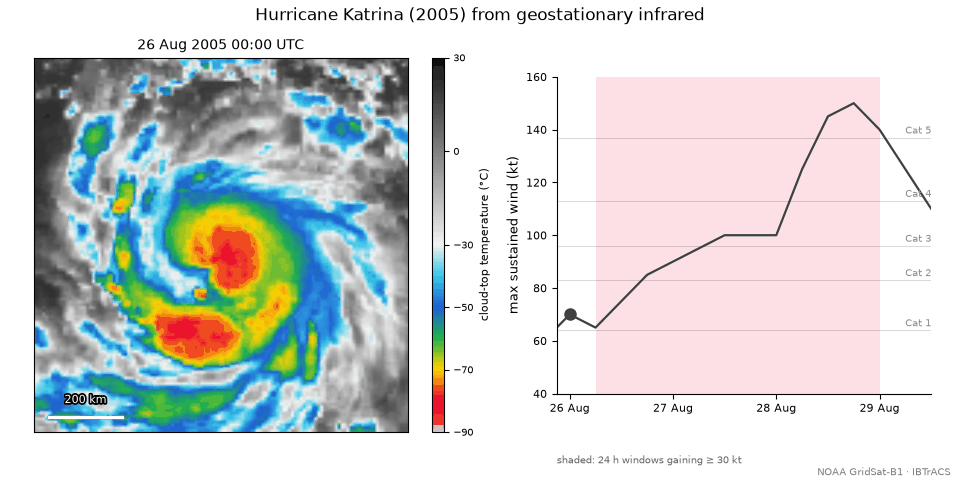
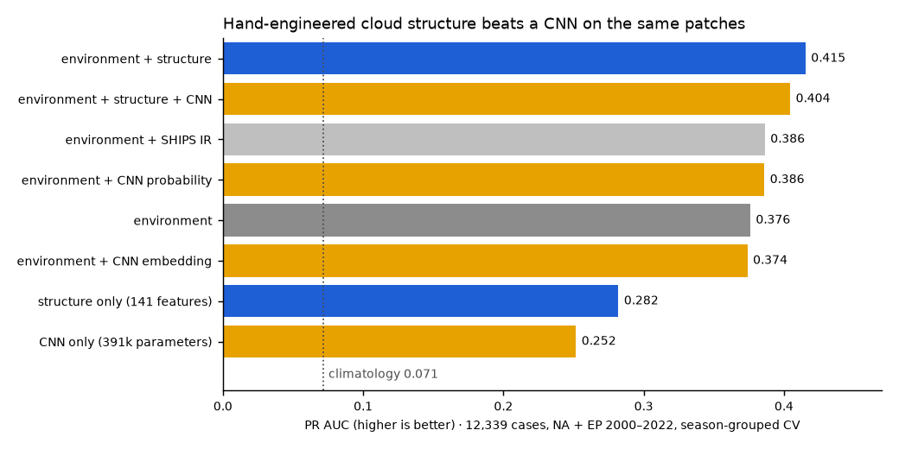

# Can a satellite see a storm about to explode?

**衛星雲圖看得出颱風即將爆發增強嗎？**

[](LICENSE)




Rapid intensification (RI), a tropical cyclone gaining **≥30 kt in 24 hours**,
is the forecast failure that hurts most: a storm that was manageable at
bedtime is a major hurricane by morning. Hurricane Otis (2023) went from a
tropical storm to Category 5 in about a day before striking Acapulco, far
beyond what operational forecasts predicted. This repository asks whether the
**structure of a storm's cloud tops**, as seen from geostationary infrared
imagery, tells you RI is coming, beyond what the large-scale environment
already says.

**What it found so far:**

1. **Cloud structure carries real signal.** 141 hand-engineered structural
   features add ~4x more skill on top of the environment than the two
   classical satellite predictors in SHIPS do.
2. **A CNN reading the same patches does *not* beat those features yet.**
   The comparison is reported as it came out (below).
3. **The labels themselves are contaminated.** Outside the Atlantic, "best-track"
   intensity is estimated from the same infrared imagery by the Dvorak
   technique. Intensities pile up on the Dvorak table, more strongly the less
   aircraft reconnaissance a basin gets. A vision model trained there may be
   learning to imitate Dvorak analysts instead of physics.
   ([Experiment A](reports/experiment_a_report.md))



> **中文簡介**：「快速增強」指颱風 24 小時內增強 30 節以上，是颱風預報最容易失準、
> 也最危險的情況。本專案只用公開的 NOAA 衛星紅外線雲圖和最佳路徑資料，檢驗
> 「雲頂結構」能不能提前看出快速增強。目前結果：人工設計的雲結構特徵確實有用，
> 卷積神經網路還沒能超越它；同時發現沒有飛機偵察的海域（包括西北太平洋），
> 颱風強度標籤本身就受 Dvorak 判讀影響，這是用 AI 預測颱風時必須先處理的陷阱。

> **Research code, not a forecast.** For warnings use your official agency:
> NHC, JTWC, JMA, or 中央氣象署 (CWA).

Everything here runs from public data and, so far, entirely on CPU.

## Quick start

```bash
pip install -r requirements.txt
python scripts/01_download_ibtracs.py   # 144 MB best-track archive from NOAA
python scripts/02_build_labels.py       # RI labels + base-rate report
python scripts/21_readme_figures.py     # rebuild the GIF above from GridSat-B1
```

The last step reads ~28 small storm boxes through NCEI's OPeNDAP server. If
that server is down, download the whole files from the
[AWS mirror](https://registry.opendata.aws/noaa-cdr-gridsat-b1/) and pass
`--gridsat-dir`. The full pipeline is under [Pipeline](#pipeline).

## Status

| Stage | State |
|---|---|
| RI labels from IBTrACS | done |
| SHIPS statistical baseline | done — see [reports/baseline_report.md](reports/baseline_report.md) |
| Storm-centred IR patch extraction | done (GridSat-B1) — see [reports/patch_pipeline_report.md](reports/patch_pipeline_report.md) |
| Storm-centred patches, NA+EP 2000-2022 | 13,097 complete sequences, validated at r = 0.9914 |
| Structural features vs classical IR | done — see [reports/structure_report.md](reports/structure_report.md) |
| Vision model | training harness built, benchmarked on an RTX 4060 |
| Experiment A — label provenance | statistical half done — see [reports/experiment_a_report.md](reports/experiment_a_report.md); vision half needs the global archive |

## Headline numbers

* **1,094 independent RI episodes** in the 2000–2022 satellite era, over water,
  globally. Not 3,718 — consecutive 6-hourly hits inside one intensification
  burst are near-duplicates. This is a small-data problem.
* Base rate **9.2%**. Accuracy is meaningless here and is never reported.
* Best statistical baseline (gradient boosting, environment + SHIPS IR
  predictors): **ROC AUC 0.891, PR AUC 0.481, BSS 0.258**.
* **Hand-engineered cloud structure adds 3.8x what the two classical IR
  predictors add** (+0.039 vs +0.010 PR AUC over environment alone), with
  deviation-angle variance the strongest single structural feature.
* The standard hand-engineered IR predictors add only **+0.019 PR AUC** once the
  large-scale environment is known. That margin is what the vision model exists
  to beat.
* Patch pipeline validated end-to-end against SHIPS' own IR predictors:
  **r = 0.984** on percent area colder than −30 °C.
* Best-track intensities are **quantized onto the Dvorak table** in every
  basin — contrast +0.499 with reconnaissance, +0.694 without, intervals
  non-overlapping — but that contamination does **not** reach models built
  on environmental predictors (transfer asymmetry −0.001).

## Data

| Source | Use | Access |
|---|---|---|
| IBTrACS v04r01 | best-track labels | NCEI, single 144 MB CSV |
| CIRA SHIPS developmental (lsdiag) | baseline predictors, 6 basins | RAMMB/CIRA, 1.3 GB of text |
| GridSat-B1 v02r01 | 3-hourly ~8 km global IR | NCEI **OPeNDAP**, subset server-side |

GridSat is read through OPeNDAP rather than by downloading files. A global file
is ~50 MB; the box around one storm is ~0.08 MB — a ~650× reduction in transfer,
which is what makes the full archive tractable without a large storage budget.

## Pipeline

```bash
python scripts/01_download_ibtracs.py
python scripts/02_build_labels.py          # RI labels + base-rate report
python scripts/03_download_ships.py        # all six basin files
python scripts/04_build_ships_table.py     # join, verified against SHIPS DELV
python scripts/05_ships_baseline.py        # LR + GBM, season-grouped CV
python scripts/06_demo_patch.py            # visual check, Katrina 2005
python -u scripts/07_extract_patches.py --basin NA --seasons 2020 --workers 10
python scripts/08_validate_patches.py NA_2020
python scripts/09_train_cnn.py --tag NA_2020 --group SID     # CPU harness
python -u scripts/10_structural_features.py --tag NA_2020    # 141 features
python -u scripts/11_structure_baseline.py --tag NA_2020     # structure vs SHIPS IR
python -u scripts/12_train_gpu.py --tag NA_2020 --group SID  # single-GPU trainer
python -u scripts/21_readme_figures.py     # the GIF and chart at the top of this page
```

`12_train_gpu.py` is written to share the machine: below-normal priority, a
quarter of the cores, 60% of VRAM and a 70% duty cycle by default, with every
fold checkpointed so Ctrl+C is safe. Pass `--duty 1.0 --workers 8 --vram 0.9`
when nothing else needs the laptop.

## Design decisions worth knowing

**Intensity comes from `USA_WIND`, not `WMO_WIND`.** WMO_WIND mixes 1-minute and
10-minute averaging across agencies, so "30 kt in 24 h" would mean different
things in different basins.

**Splits are stratified and grouped by season, never random over samples.** Cases within a
storm are heavily autocorrelated; a random split leaks badly.

**Recon-verified and Dvorak-derived cases are reported separately.** Outside the
North Atlantic and East Pacific there is no routine aircraft reconnaissance, so
best-track intensity is itself derived from the same infrared imagery via the
Dvorak technique. A model trained on those labels may be learning to reproduce
Dvorak rather than physics.

**Patches are resampled onto a fixed kilometre grid**, not cut as a fixed box in
degrees. A degree box shrinks physically as latitude rises, and a model could
learn latitude from the framing alone.

**The SHIPS baseline is perfect-prognosis** (analysis values, not forecast
values), so it is optimistic. The vision model must be held to the same standard.

## Layout

```
src/tcri/     config, ibtracs, ships, gridsat, evaluate
scripts/      numbered, run in order
data/raw/     downloads (gitignored)
data/processed/  labels, joined tables, patch memmaps (gitignored)
reports/      baseline report, validation figures
```

## Requirements

`pip install -r requirements.txt` — numpy, pandas, scikit-learn, matplotlib,
xarray, netCDF4, scipy, requests. torch is listed for the vision stage and is
not needed for anything above.

## License

Code: [MIT](LICENSE). The data are not redistributed here; every script
downloads them from the original providers (NOAA NCEI for IBTrACS and
GridSat-B1, CIRA/RAMMB for SHIPS), and they remain under those providers'
terms.
