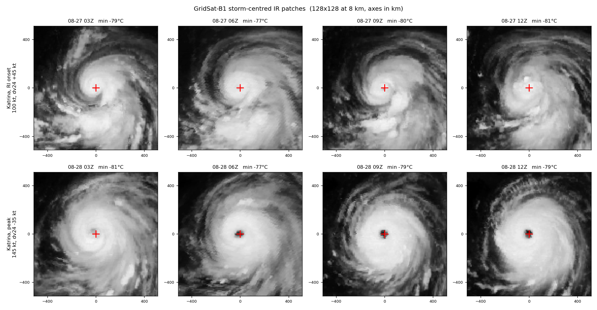
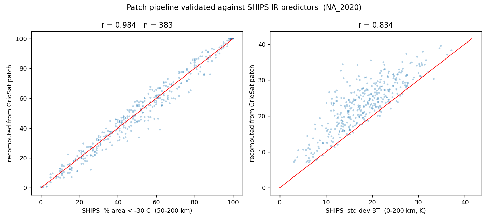

# Storm-centred IR patch pipeline (GridSat-B1)

Second half of the week 1–2 deliverable: turning labelled best-track cases into
image sequences a vision model can read. Prototype run on the 2020 North
Atlantic season.

## What it produces

For each labelled case, a 4-frame sequence at t−9, t−6, t−3 and t0 hours,
each frame a **128 × 128 patch at 8 km spacing** — a 1024 km box, ±512 km from
the storm centre. Stored as a single float16 memmap of shape
`(cases, frames, 128, 128)` plus an index CSV, so the training loader can slice
it without unpacking anything. That is 128 KB per case; the full global archive
would be roughly 5 GB.

GridSat-B1's 3-hourly grid (00/03/…/21 UTC) contains all four best-track
synoptic hours, so the pre-t0 frames need no temporal interpolation. Storm
centres for the off-synoptic frames come from IBTrACS' own 3-hourly positions.

## The access decision that matters

GridSat is read through **NCEI's OPeNDAP server with server-side subsetting**,
not by downloading files.

| | |
|---|---|
| Whole global file | ~50 MB |
| Box around one storm | ~0.08 MB |
| Reduction in transfer | **~650×** |

Opening a remote file initially cost 16.7 s, almost all of it spent reading the
`sparse3ir` coordinate variable — 3.1 million elements that this work never
touches. Dropping it and the other unused variables cuts the open to **2.0 s**.
Since opening dominates, work is grouped by *frame time* rather than by case:
one file serves every storm alive at that moment.

Measured throughput with 10 worker processes: **2.6 files/s**. The 2020 North
Atlantic season needed 570 distinct times for 412 cases (2.8 frames per file).
Extrapolating to the full 2000–2022 global archive, roughly 46,000 distinct
times, gives about **5 hours of wall clock and negligible storage**.

## Prototype run: North Atlantic 2020

| | |
|---|---|
| Cases | 412 (35 RI, 8.50%) across 29 storms |
| Frames required | 1,597 across 570 distinct times |
| Failed file reads | 0 |
| Cases with all 4 frames | **383 / 412 (93.0%)**, 34 RI |
| Array size | 0.05 GB |

The 7% loss is cases near genesis where the storm has no best-track position 9
hours earlier, plus frames exceeding the 5% missing-pixel threshold. Nothing was
lost to read errors.

## Validation

### Visual



Two sequences from Hurricane Katrina (2005). Top row, at the onset of rapid
intensification (100 kt, dv24 = +45 kt): a ragged, asymmetric central dense
overcast with no eye. Bottom row, 24 hours later at peak (145 kt): a clear warm
eye inside a symmetric ring of −80 °C cloud tops, sitting exactly on the centre
marker. This is the structural difference the model is meant to read.

### Quantitative, against SHIPS' own IR predictors

SHIPS publishes IR statistics computed independently from operational GOES
imagery. Recomputing them from our GridSat patches tests the entire chain at
once — geolocation, storm centring, the kilometre scaling of the grid, the
brightness-temperature units, and the array orientation. Any of those being
wrong would destroy the correlation.



**Percent of the 50–200 km annulus colder than −30 °C** (n = 383):

| | |
|---|---|
| Correlation | **0.9836** |
| Bias (ours − SHIPS) | −0.44 percentage points |
| Mean absolute error | 3.64 percentage points |

That settles it. The pipeline is geolocated, centred, scaled and oriented
correctly.

### One discrepancy, characterised rather than waved away

The second predictor, **standard deviation of BT within 200 km**, correlates at
0.834 but with a +5.05 K offset. Sweeping the radius shows why:

| radius | our mean (K) | bias vs SHIPS | correlation | MAE |
|---|---|---|---|---|
| 75 km | 15.51 | −2.63 | 0.799 | 4.43 |
| **100 km** | 17.90 | **−0.23** | 0.877 | 3.02 |
| **125 km** | 19.86 | +1.72 | **0.910** | 2.77 |
| 150 km | 21.33 | +3.19 | 0.902 | 3.46 |
| 200 km *(nominal)* | 23.19 | +5.05 | 0.834 | 5.13 |
| 250 km | 24.23 | +6.09 | 0.738 | 6.30 |

SHIPS' documented "0–200 km" statistic behaves numerically like a **~100–125 km
effective radius**. The mean brightness temperature over the same nominal disc
agrees in the same direction: SHIPS is 4.06 K colder than ours (correlation
0.966), and a colder mean together with a smaller spread is what a region more
concentrated on the cold core would give.

The cause is not resolvable from the CIRA documentation, and it does not matter
for this project: the annulus predictor — the one that actually tests geometry —
matches almost exactly, and the vision model reads the raw patches rather than
reproducing SHIPS' scalars. It is recorded here because anyone reusing SHIPS'
disc statistics as ground truth should know about it.

### A negative result worth keeping

Correlation between the coldest pixel in the patch and current intensity is only
**−0.15**. Weak, and correctly so: a single overshooting top says little about a
storm's strength, which is precisely the reason summary statistics of IR imagery
underperform and the reason for looking at structure instead.

## Reproducing

```bash
python scripts/06_demo_patch.py
python scripts/07_extract_patches.py --basin NA --seasons 2020 --workers 10
python scripts/08_validate_patches.py NA_2020
```

Runs on CPU. No GPU used.
